# Tutorial: planning a project across teams

This tutorial follows one fictional company through the most common tasks in the planner: setting up projects, building a plan, sharing tasks between teams, negotiating changes, and reporting. Read it from start to finish, or jump to the task you need. Each section stands on its own.

You need an installed planner and an account. If you don't have those yet, see [Getting started](getting-started.md). The [User guide](user-guide.md) is the full reference.

The company, people and dates are invented. The pictures are taken from the real application.

## The company and the project

**Kestrel Marine Systems** builds automation for harbour equipment. It has won a contract to automate the four container cranes at the **Port of Eastmere**. Three groups have to work together, and each one needs its own plan:

- The **mechanical team** fits sensors and drives to the cranes.
- The **software team** can't integrate the sensors until they are installed.
- The **customer** wants firm dates that can only change by agreement.

| Person         | Job                        | Role in the planner                                   |
| -------------- | -------------------------- | ----------------------------------------------------- |
| Priya Nair     | Programme manager, Kestrel | ADMIN on the programme and its subprojects            |
| Tomas Lindgren | Mechanical lead, Kestrel   | PLAN_OWNER of _Retrofit plan_, VIEWER everywhere else |
| Ada Chen       | Software lead, Kestrel     | PLAN_OWNER of _Software plan_, VIEWER everywhere else |
| Marta Silva    | Customer's representative  | PLAN_OWNER of _Customer contract_                     |

The work is split into a programme with two subprojects:

| Project                   | Plans                               |
| ------------------------- | ----------------------------------- |
| Eastmere Crane Automation | Customer contract, Programme master |
| └ Crane Retrofit          | Retrofit plan                       |
| └ Control Software        | Software plan                       |

The story takes place on Monday 14 September 2026, which is where the red "today" line sits in the pictures.

## 1. Set up the project structure

_Priya signs in and creates the subprojects._

On the Projects page, the form below the tree creates a project. To make a subproject, choose its **Parent project**.

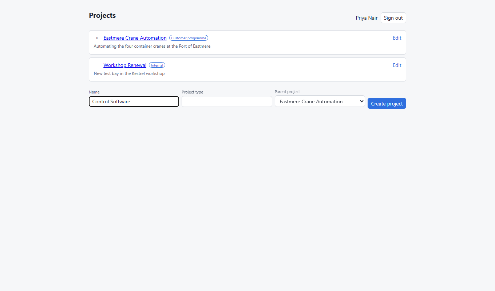

Choose **Create project**. The tree opens to show the new project. Whoever creates a project becomes its administrator.

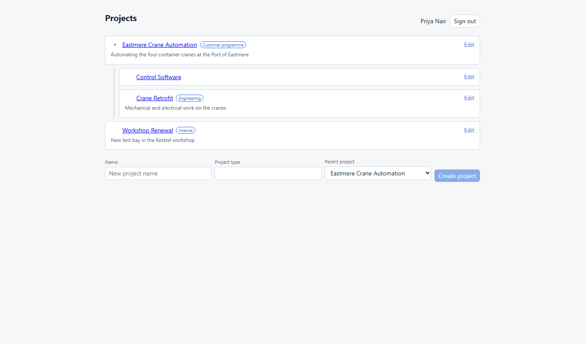

Use **Edit** on a project to change its name, type, description or parent.

## 2. Add plans and people

_Priya adds the plans and gives each person a role._

Click a project's name to open its workspace, and choose **Project** in the top bar. The Project panel has three jobs:

1. **Plans:** the structure tree lists plans and subprojects. Add a plan with the **Plan name** field and **Add plan**. The person who adds a plan becomes its owner.
2. **Members:** choose a **User**, a **Plan** (or _All plans_) and a **Role**, then **Assign**.
3. **Navigation:** click any plan in the tree to open it, including plans in subprojects.

Here Priya makes Marta the owner of the contract plan, which lets Marta approve its dates without having any say over Kestrel's internal plans.

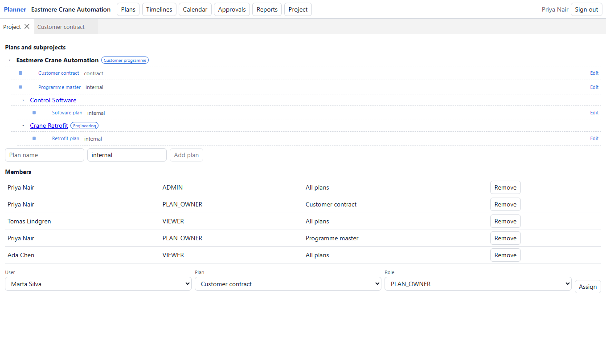

Roles are set per project, so someone who works across subprojects needs a role in each one. Tomas and Ada get VIEWER on all three projects, so they can see each other's work.

## 3. Build a plan

_Tomas builds the retrofit plan._

Open the plan and choose **+ Task**. Enter a name, start, duration and unit.

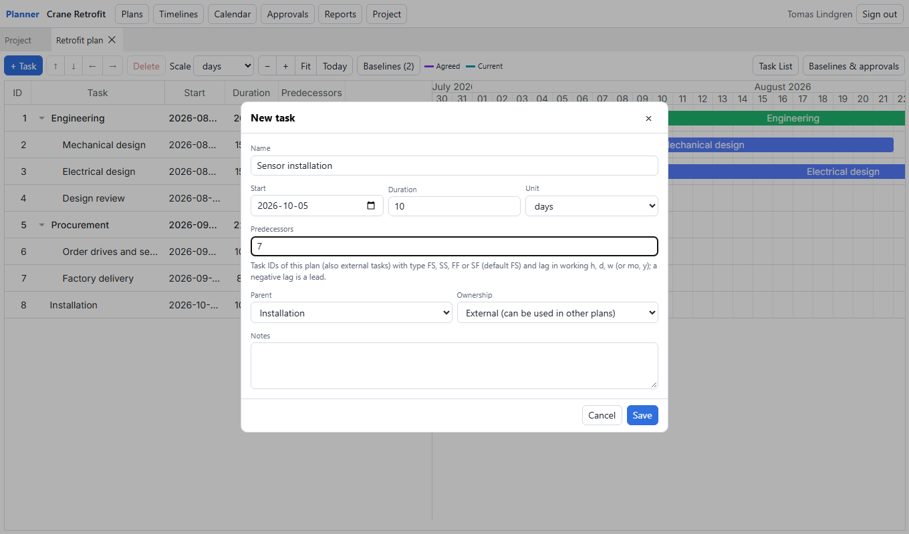

Three fields do most of the structuring work:

- **Parent** places the task under another one. A task with subtasks becomes an _activity_, and its dates follow its subtasks.
- **Duration 0** makes the task a _milestone_, drawn as a diamond.
- **Predecessors** links tasks by ID. `7` means "starts after task 7 finishes". `2SS+5d` means "starts 5 working days after task 2 starts".

Set **Ownership** to _External_ if other plans will use the task. Tomas does this for Sensor installation because the software team depends on it.

Choose **Fit** to see the whole plan.

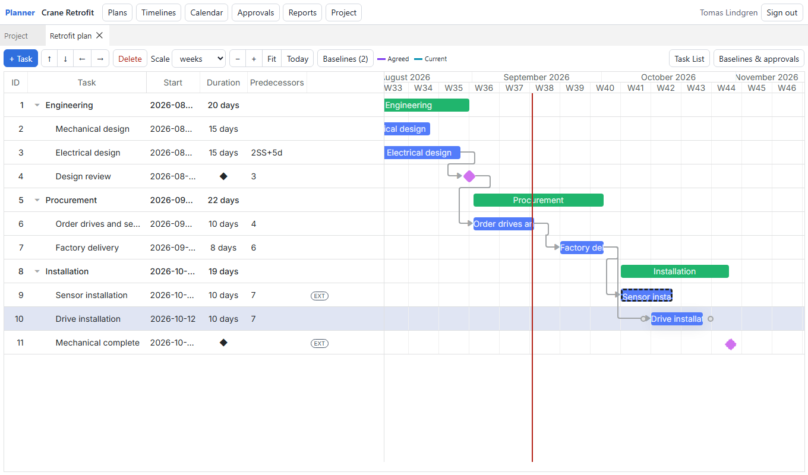

Drag a bar to move it, or drag its end to change the duration. The arrows ↑ ↓ reorder tasks, and ← → change their level in the hierarchy.

### When dates don't fit

The planner never moves a task for you, but it does tell you when dependencies are broken. Tomas first starts Drive installation on 28 September, before Factory delivery (task 7) has finished. The link turns red and the task gets a **⚠ DEP** badge. Hover over the badge to read the explanation.

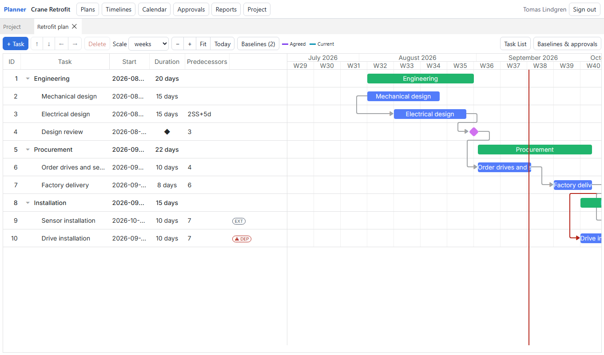

Moving Drive installation to 12 October clears the warning.

## 4. Share tasks between plans

_Priya connects the software plan to the retrofit plan._

The software team needs to see Sensor installation in its own plan. Adding a task to a plan requires edit rights on that plan and membership of the owner's project. Priya has both on these plans.

1. Open the owner's plan and choose **Task List**.
2. Open the receiving plan's Gantt.
3. Drag the task list's tab to the side of the window so that both are visible.
4. Drag the task from the list onto the Gantt.

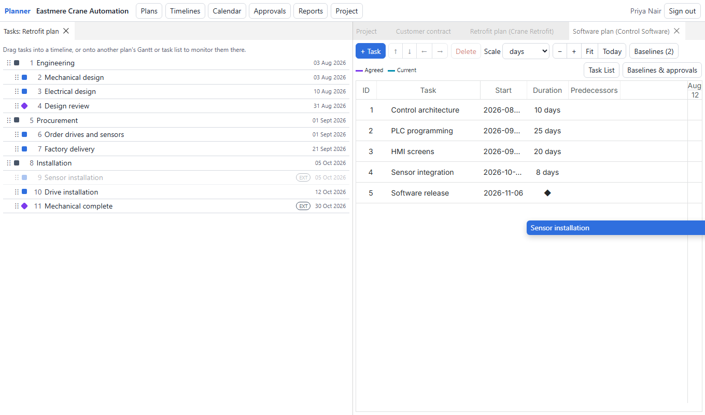

The task now appears in the software plan as a live reference. Its name, dates and duration always come from the owner, so there is no copy to keep up to date. Local tasks can depend on it through its local ID.

A dropped task starts as **MONITOR**. Since the software schedule depends on this date, Priya double-clicks the task and chooses **Upgrade to AGREEMENT**.

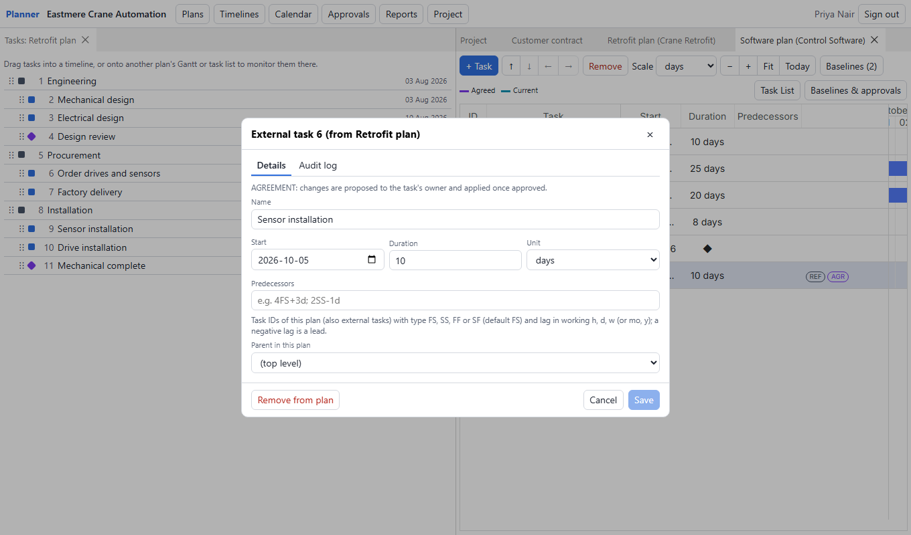

| Type      | What it means                                                                         |
| --------- | ------------------------------------------------------------------------------------- |
| MONITOR   | The receiving plan sees changes as they happen. Nobody has to approve anything.       |
| AGREEMENT | Neither side can change the schedule alone. A change has to be proposed and approved. |

The type is set for each use of a task, so one task can be AGREEMENT towards one plan and MONITOR towards another. The owner sees this in its own plan: Sensor installation shows **EXT 2**, **AGR** and **MON**. Hover over a badge to see which plans it refers to.

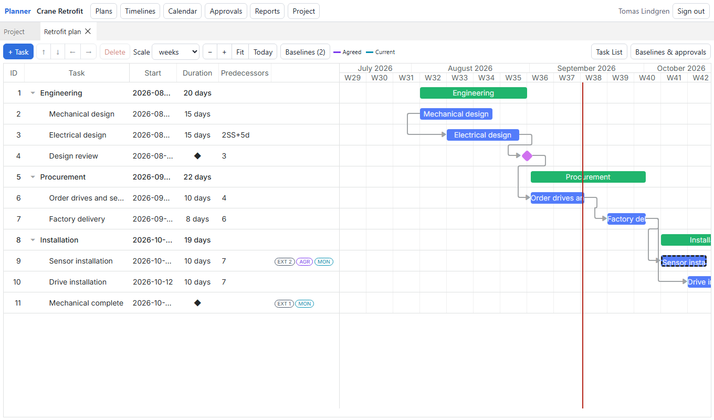

## 5. Commit to dates

_Tomas commits a task to the Current track._

Every plan has three versions of its schedule. **Estimated** is the live plan, **Current** is what the team has committed to, and **Agreed** is what has been agreed with other parties. Tasks move forward through approvals.

Open a task and choose **Request: Estimated → Current**. The request appears under **Approvals** in the top bar for whoever can decide it. Add a comment if you want one, then choose **Approve** or **Reject**.

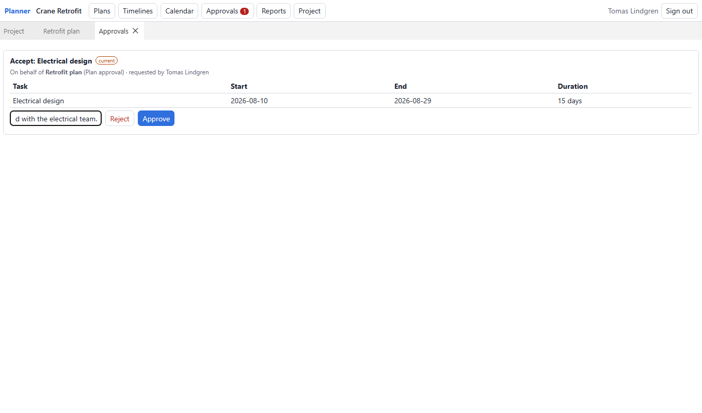

To commit everything at once, use **Baselines & approvals → Request whole plan: Estimated → Current**.

## 6. Negotiate a change

Under AGREEMENT, changes can start from either side.

### The receiving plan proposes

_Ada needs more time for sensor installation._

Ada opens the task in the software plan and changes the duration from 10 to 14 days. The save button now reads **Propose change**, and there is a field for the reason.

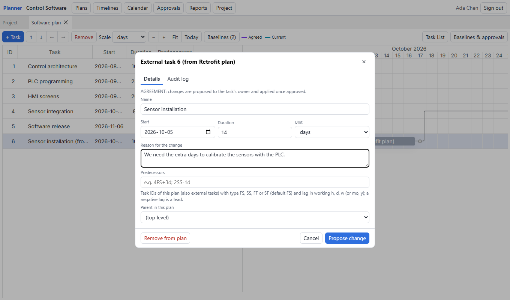

Nothing moves yet. The task gets a **PEND** badge, and a dashed outline shows the proposed dates next to the real ones.

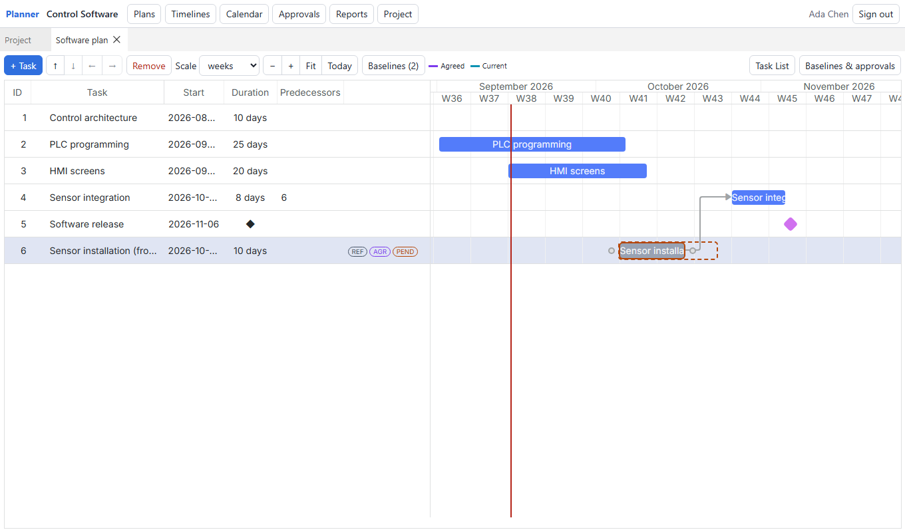

### The owner decides

_Tomas reviews the proposal._

Tomas can use the Approvals panel, or decide from the task itself: the task dialog lists open requests under **Pending approvals**. Approving applies the change in every plan that uses the task. Rejecting leaves everything as it was.

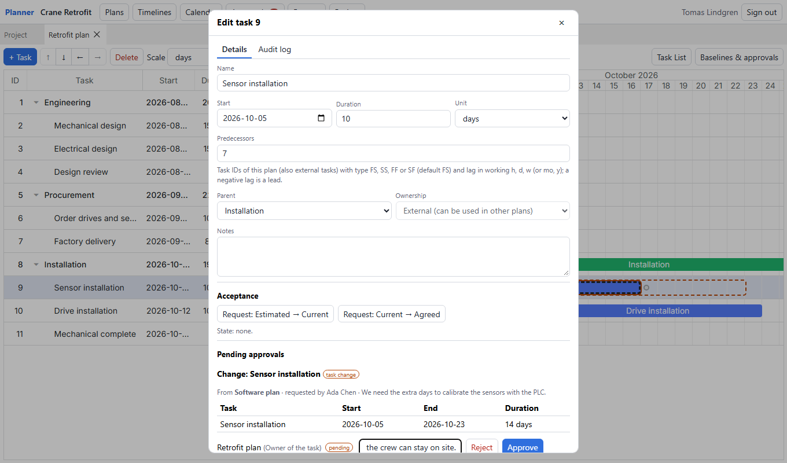

### The owner proposes

_The drives arrive late, so Tomas has to move the task._

Owning a task doesn't let Tomas move it alone, because the software team depends on it. When Tomas changes the start date, the button reads **Propose change** here too, and the request goes to every plan using the task under AGREEMENT. Ada approves it under **Approvals**, and only then does the task move.

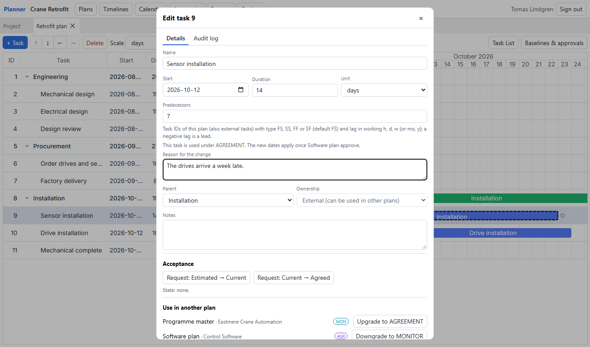

Names, notes and hierarchy aren't part of the agreement and change at once. So do tasks that are internal or only used under MONITOR.

### See what happened

Every task dialog has an **Audit log** tab with changes, requests, decisions and comments, newest first.

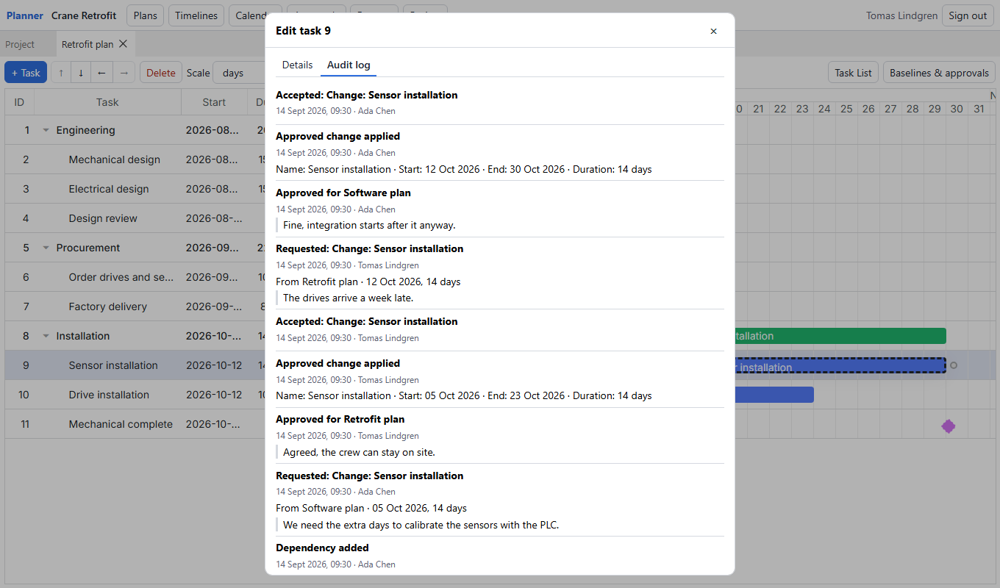

## 7. Track progress against a baseline

_Tomas freezes the design and later compares against it._

Open **Baselines & approvals**, enter a name and choose **Snapshot (locked)**. A locked snapshot can never be changed. The same panel compares the live plan with any baseline, and can create what-if branches with **Branch from live**.

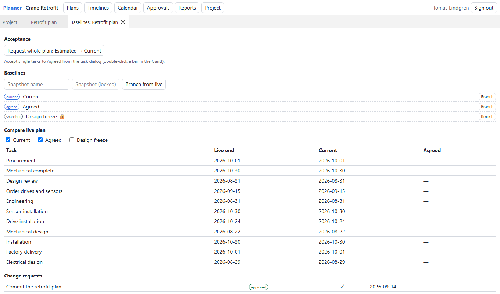

Later, procurement slips by a week. To see the effect, open the **Baselines** menu in the Gantt toolbar and tick the snapshot. Each baseline is drawn as a thin line under the bars, in the colour shown in the legend. Here Factory delivery and Drive installation have clearly moved to the right of where they were.

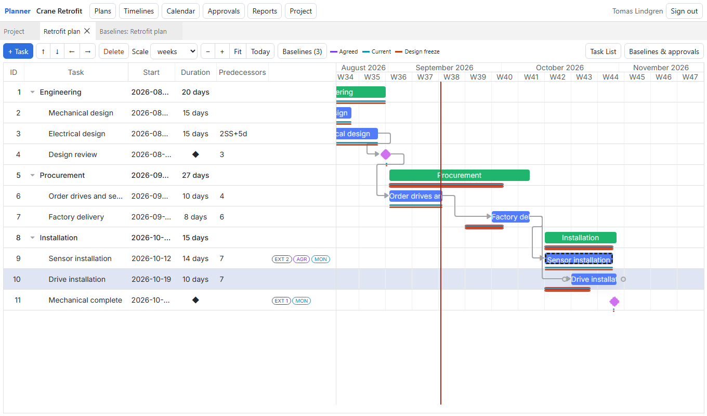

## 8. Agree dates with the customer

_Priya asks Marta to agree the factory acceptance test._

Once a task is in Current, **Request: Current → Agreed** in the task dialog asks for agreement. Internal tasks need the plan's approvers. External tasks need the owner and every plan using them, so the task only becomes agreed when all of them have approved.

Marta sees the request under **Approvals**, on behalf of the Customer contract plan.

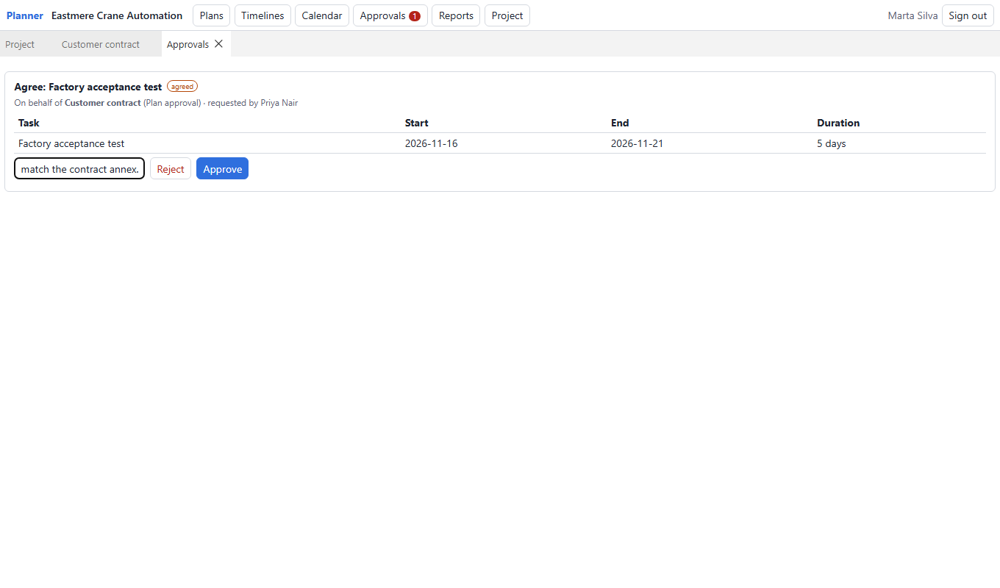

If a recipient rejects a task that is already in Current, the task stays there but is marked as rejected, so the disagreement remains visible until it is resolved.

## 9. Show the big picture on a timeline

_Priya prepares a roadmap for the steering committee._

Choose **Timelines → + New timeline** and name it. Set the time span and scale, and add a row for each team. Then drag tasks in from a **Task List**. The row you are over is highlighted.

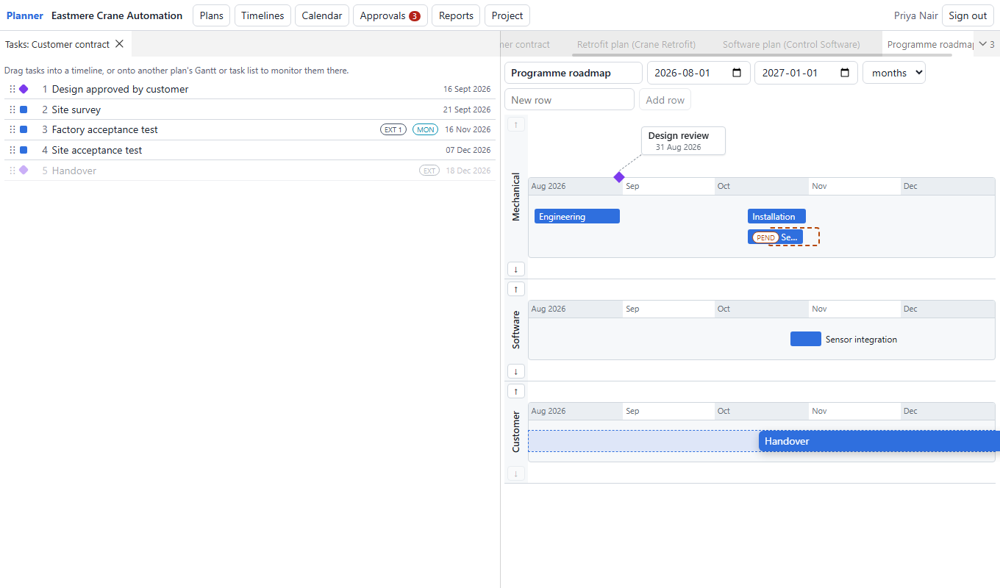

A timeline shows the tasks themselves, so it updates when the plans do. Drag an entry above or below the bar area to turn it into a callout, and place it freely. Tasks can come from any project you can read.

Open proposals appear here too. In the picture below, Sensor installation has a **PEND** badge and a dashed outline at the proposed dates.

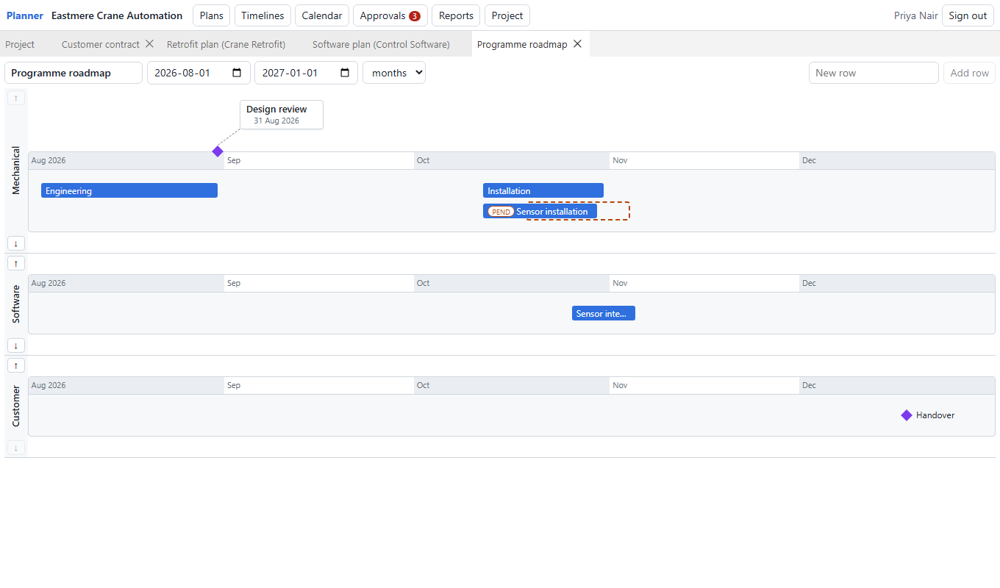

## 10. Check the calendar and create a report

**Calendar** in the top bar shows tasks as events and milestones as markers. Use the checkboxes to choose plans, and the buttons to switch between day, week, month and year.

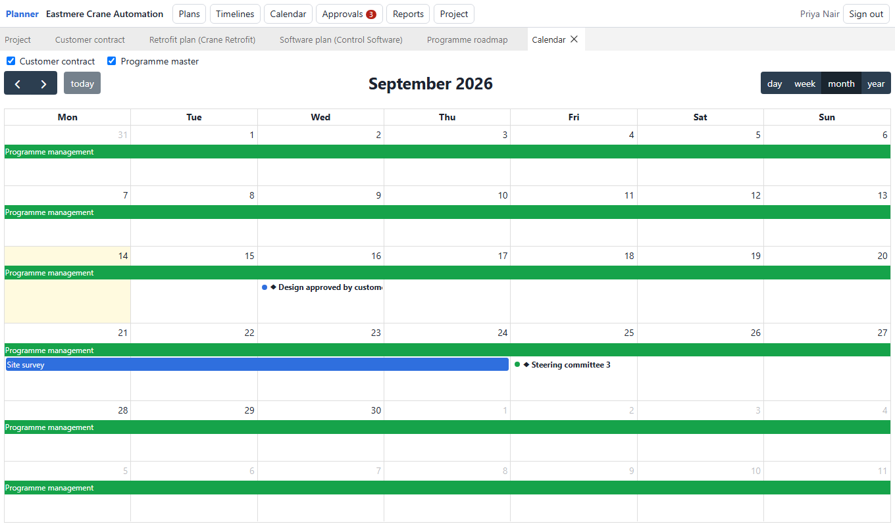

**Reports** saves a report setup that you can run again at any time. Choose **+ Report**, give it a name, tick the plans and choose **Save report**.

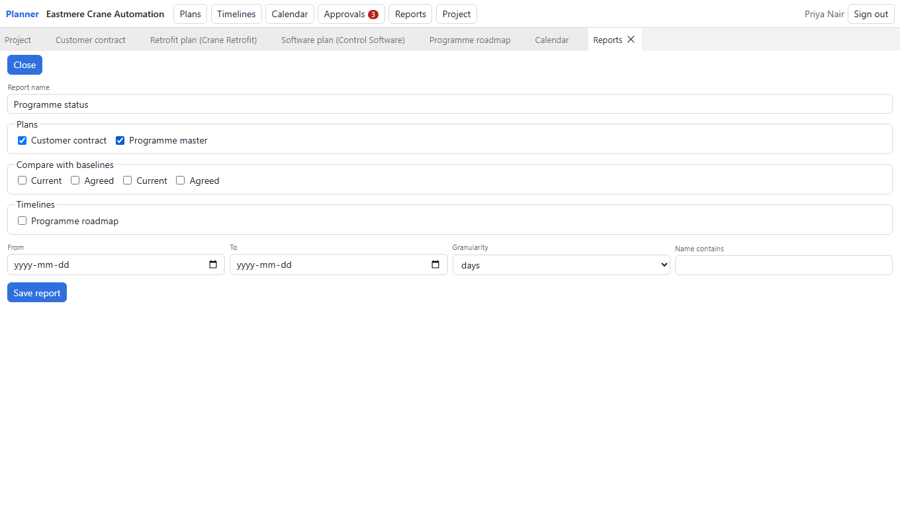

Then choose **Preview**, **PDF** or **CSV**. The same setup and the same data always give the same result.

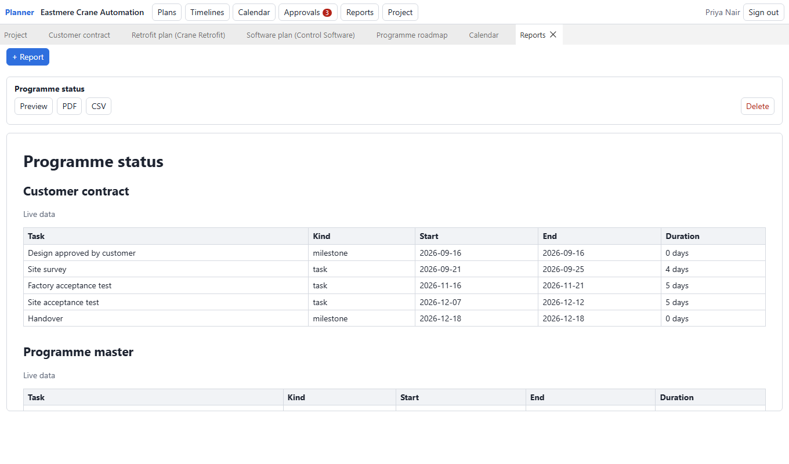

## Where to go next

- [User guide](user-guide.md): every feature in detail, including what-if branches and all the dependency types.
- [Server administration](admin-guide.md): installation, sign-in, storage and connecting AI assistants.

## For maintainers: updating the pictures

The pictures come from a script that plays this story against a real server, with the clock set to the tutorial's date. It is in [tests/docs/tutorial.images.ts](../tests/docs/tutorial.images.ts).

```
npm run docs:images
```

`npm run build` runs it too, after building the application. The build keeps the existing pictures if Chromium isn't installed (`npx playwright install chromium`) or if `SKIP_DOCS_IMAGES=1` is set.
